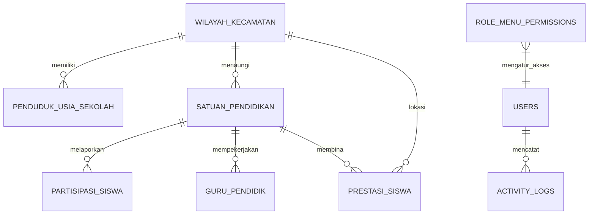

# SIMAK DINDIKPORA Banjarnegara
### Sistem Informasi Akuntabilitas Kinerja Pendidikan

<p align="center">
  
</p>

<p align="center">
  <strong>Dinas Pendidikan, Kepemudaan, dan Olahraga Kabupaten Banjarnegara</strong><br>
  <em>Platform Digital Terpadu Monitoring, Evaluasi, dan Pelaporan Capaian Kinerja Pendidikan Daerah (SAKIP & Renstra 2025–2029)</em>
</p>

<p align="center">
  
  
  
  
  
  
  
</p>

---

## 📌 Daftar Isi

- [Tentang SIMAK](#-tentang-simak)
- [Fitur Utama](#-fitur-utama)
- [Arsitektur & Tumpukan Teknologi](#-arsitektur--tumpukan-teknologi)
- [Prasyarat Sistem](#-prasyarat-sistem)
- [Panduan Instalasi](#-panduan-instalasi)
- [Akun Pengguna Bawaan (Demo)](#-akun-pengguna-bawaan-demo)
- [Struktur Database & Relasi Model](#-struktur-database--relasi-model)
- [Struktur Direktori Proyek](#-struktur-direktori-proyek)
- [Pengujian Otomatis (Testing)](#-pengujian-otomatis-testing)
- [Standar Kode & Pemformatan](#-standar-kode--pemformatan)
- [Tata Kelola & Kontribusi](#-tata-kelola--kontribusi)
- [Lisensi](#-lisensi)

---

## 📖 Tentang SIMAK

**SIMAK (Sistem Informasi Akuntabilitas Kinerja Pendidikan)** adalah aplikasi web terpadu yang dirancang dan dikembangkan untuk **Dinas Pendidikan, Kepemudaan, dan Olahraga (DINDIKPORA) Kabupaten Banjarnegara**. 

Sistem ini berfungsi sebagai instrumen digital utama dalam perencanaan, pengumpulan data terdistribusi dari 20 kecamatan, pemantauan indikator makro, evaluasi capaian, serta penyusunan pelaporan akuntabilitas instansi pemerintah berstandar nasional (**SAKIP / LKjIP**) sesuai kerangka **Rencana Strategis (Renstra) 2025–2029**.

Dengan SIMAK, pimpinan, analis perencana, serta operator wilayah dapat memantau status partisipasi sekolah, pemerataan sertifikasi pendidik, sebaran mutu satuan pendidikan, hingga perolehan prestasi siswa secara *real-time* berbasis data presisi dan analisis spasial (GIS).

---

## 🚀 Fitur Utama

### 1. Dashboard Kinerja Eksekutif & Early Warning System (EWS)
- **Ringkasan Indikator Makro**: Nilai capaian IKK Renstra, Nilai AKIP, Rata-rata Lama Sekolah (RLS), dan Harapan Lama Sekolah (HLS) Kabupaten Banjarnegara.
- **Grafik Interaktif**: Analisis tren dan komparasi capaian antar-jenjang (PAUD, SD, SMP, SMA/SMK) menggunakan [Chart.js](https://www.chartjs.org/).
- **Early Warning System (EWS)**: Deteksi otomatis deviasi capaian riil terhadap target Renstra untuk memetakan kecamatan berstatus *Warning* atau memerlukan intervensi prioritas.
- **Filter Multi-Tahun**: Navigasi tahun evaluasi dinamis (2024–2029).

### 2. Analisis Indikator Kinerja Kunci (IKK)
Sistem menyediakan modul kalkulasi dan tabulasi rinci untuk indikator-indikator pendidikan utama:
- **APK (Angka Partisipasi Kasar)**: Mengukur rasio total siswa yang terdaftar pada jenjang tertentu terhadap jumlah penduduk pada kelompok usia sekolah yang bersesuaian.
- **APM (Angka Partisipasi Murni)**: Mengukur persentase siswa kelompok usia resmi sekolah yang bersekolah pada jenjang yang tepat (SD: 7–12 tahun, SMP: 13–15 tahun).
- **APS (Angka Partisipasi Sekolah)**: Mengukur proporsi anak usia sekolah yang masih berpartisipasi dalam pendidikan formal di semua jenjang.
- **Pemerataan Sertifikasi Guru**: Analisis rasio guru bersertifikat pendidik berdasarkan status kepegawaian (PNS, PPPK, Guru Honorer/GTT).
- **Mutu PAUD Terakreditasi**: Pemantauan proporsi satuan PAUD yang telah terakreditasi minimal predikat **B** menuju target PAUD Holistik Integratif.

### 3. Master Data Pendidikan & Wilayah (20 Kecamatan)
- **Tujuan 1 (Demografi Usia Sekolah)**: Agregat kependudukan usia 0–4 tahun, 5–6 tahun, 7–12 tahun, 13–15 tahun, 16–18 tahun, serta 16–30 tahun untuk 20 kecamatan di Kabupaten Banjarnegara.
- **Tujuan 2 (Prestasi Siswa)**: Modul pencatatan prestasi akademik, seni budaya, olahraga, sains, teknologi, dan keagamaan dari tingkat Kabupaten, Provinsi, Nasional, hingga Internasional (OSN, FLS2N, O2SN, POPDA, MTQ, Robotik).
- **Satuan Pendidikan (Sekolah)**: Master data sekolah se-Banjarnegara mencakup NPSN, jenjang (PAUD, SD/MI, SMP/MTs, SMA/SMK), status negeri/swasta, akreditasi (A, B, C, Belum Terakreditasi), data pimpinan sekolah, kontak, dan titik koordinat geografis.
- **Partisipasi Siswa (Dapodik)**: Sinkronisasi data rombongan belajar (rombel), usia siswa, dan total daya tampung sekolah per tahun ajaran.
- **Pendidik & Tenaga Kependidikan (PTK)**: Basis data guru dengan NIP, NUPTK, mata pelajaran/bidang studi, jenis kelamin, serta status sertifikasi profesi.

### 4. Perencanaan & Akuntabilitas (SAKIP & Renstra 2025–2029)
- **Target Renstra 2025–2029**: Manajemen target indikator proyeksi lima tahunan secara sistematis.
- **Realisasi Capaian Kinerja**: Dokumentasi capaian kinerja tahun berjalan vs tahun sebelumnya ($N-1$), penetapan status predikat kinerja (*Sangat Baik, Baik, Cukup, Kurang*), catatan evaluasi komprehensif, dan rekomendasi tindak lanjut.
- **Dokumen Resmi LKjIP Siap Cetak (A4 Layout)**: Format Laporan Kinerja Instansi Pemerintah resmi berstandar **PermenPAN-RB** yang terformat khusus untuk cetak kertas A4 (*print-ready layout*, *page-break styling*, tanda tangan pimpinan, dan matriks rekapitulasi capaian).

### 5. Peta Sebaran Spasial (Interactive Leaflet GIS)
- **Peta Poligon GeoJSON 20 Kecamatan**: Batas wilayah spasial resmi Kabupaten Banjarnegara (Susukan, Klampok, Mandiraja, Bawang, Banjarnegara, Punggelan, Karangkobar, Batur, Wanayasa, Kalibening, dll.).
- **Visualisasi Tematik (Choropleth)**: Pewarnaan interaktif gradasi capaian APK per kecamatan (*Tinggi/Hijau, Sedang/Kuning, Rendah/Merah*).
- **Marker Satuan Pendidikan**: Peta sebaran titik lokasi sekolah dengan popup informasi akreditasi, jenjang, dan jumlah siswa.

### 6. Mesin Ekspor & Impor Data Native (Zero-Dependency OpenXML)
- **Engine Ekspor Excel (.xlsx) Murni**: Menghasilkan file spreadsheet Microsoft Excel standar biner `.xlsx` tanpa ketergantungan library pihak ketiga yang berat (murni memanfaatkan ekstensi PHP `ZipArchive` dan spesifikasi XML Open Packaging Conventions).
- **Proteksi Teks Identitas Ketat**: Mencegah program Excel mengonversi nomor penting seperti **NIP (18 digit), NUPTK (16 digit), NPSN (8 digit), NISN, dan Nomor Telepon** menjadi notasi ilmiah yang merusak data (contoh: `1,99E+17`).
- **Fitur Impor & Validasi CSV/Excel**: Importir data massal untuk data demografi penduduk usia sekolah dan data prestasi siswa lengkap dengan template unduhan.

### 7. Keamanan, Tata Kelola & Audit Trail
- **Manajemen Pengguna Berbasis Peran (RBAC)**: Pembagian kewenangan menjadi 4 tingkatan peran (*Pimpinan, Perencana, Operator, Super Admin*).
- **Matriks Hak Akses Menu Dinamis (Role Menu Permission Matrix)**: Administrator dapat mengubah izin akses setiap modul menu pada sidebar secara langsung melalui antarmuka web tanpa menyentuh kode program.
- **Log Audit Trail**: Pencatatan riwayat aktivitas pengguna secara otomatis (User ID, IP Address, Model, Aksi Create/Update/Delete, User Agent, dan Timestamp).
- **Panduan & SOP SAKIP**: Modul glosarium istilah dan pedoman standar operasional prosedur implementasi SAKIP bidang pendidikan.

---

## 🛠 Arsitektur & Tumpukan Teknologi

| Komponen | Teknologi | Keterangan |
| :--- | :--- | :--- |
| **Bahasa Pemrograman** | PHP 8.3+ | Menggunakan fitur modern PHP 8.3 (Constructor Promotion, Type Hinting, Attributes) |
| **Framework Backend** | Laravel 13.x / 12.x | Arsitektur MVC, Eloquent ORM, Service Layer Pattern, Form Request Validation |
| **Basis Data** | MySQL 8.0+ / MariaDB / SQLite | Relasi tabel terindeks dengan integrity constraints & cascading rules |
| **Styling & Tampilan** | Tailwind CSS v4.0 | Modern utility-first framework via `@tailwindcss/vite` |
| **Interaktivitas UI** | Alpine.js v3.14 | State management reaktif ringan untuk modal, dropdown, dan sidebar responsive |
| **Visualisasi Grafik** | Chart.js | Visualisasi diagram batang, garis, dan donat untuk indikator kinerja |
| **Peta Spasial (GIS)** | Leaflet.js v1.9.4 & GeoJSON | Peta vektor dan raster spasial batas 20 kecamatan Banjarnegara |
| **Mesin Spreadsheet** | Native PHP OpenXML Engine | Generator `.xlsx` berbasis ZipArchive & OpenXML tanpa bloating vendor |
| **Pengujian (Testing)** | PHPUnit 12.x | 32 Test Suites, 173 Assertions, 100% Endpoint & Service Coverage |
| **Standarisasi Kode** | Laravel Pint | Pemformatan otomatis mengikuti PSR-12 dan Laravel Pint Standards |

---

## ⚙️ Prasyarat Sistem

Sebelum melakukan instalasi SIMAK, pastikan lingkungan server atau workstation Anda memenuhi kriteria berikut:

1. **PHP**: Versi `>= 8.3`
   - Ekstensi PHP wajib aktif:
     - `ext-zip` (Wajib untuk mesin ekspor & impor `.xlsx`)
     - `ext-pdo` & `ext-pdo_mysql` (atau `ext-pdo_sqlite`)
     - `ext-mbstring`
     - `ext-openssl`
     - `ext-tokenizer`
     - `ext-xml` & `ext-simplexml`
     - `ext-ctype`
     - `ext-json`
     - `ext-curl`
     - `ext-fileinfo`
2. **Composer**: Versi `>= 2.2`
3. **Node.js & NPM**: Node.js `>= 18.x` & NPM `>= 9.x`
4. **Database Server**: MySQL `>= 8.0`, MariaDB `>= 10.4`, atau SQLite `>= 3`
5. **Web Server**: Laragon / Apache / Nginx / PHP Built-in CLI Server

---

## 💻 Panduan Instalasi

Ikuti langkah-langkah instalasi berikut untuk menjalankan SIMAK di lingkungan lokal maupun server staging:

### 1. Kloning Repositori
```bash
git clone https://github.com/<username-atau-organisasi>/simak.git
cd simak
```

### 2. Instalasi Dependensi PHP (Composer)
```bash
composer install --optimize-autoloader
```

### 3. Konfigurasi Berkas Lingkungan (`.env`)
Salin berkas template lingkungan `.env.example` menjadi `.env`:

*Di Linux / macOS:*
```bash
cp .env.example .env
```

*Di Windows (Command Prompt / PowerShell):*
```powershell
copy .env.example .env
```

### 4. Pembuatan Kunci Aplikasi (Application Key)
```bash
php artisan key:generate
```

### 5. Pengaturan Koneksi Database
Buka berkas `.env` dengan editor teks dan sesuaikan parameter basis data Anda:

```env
DB_CONNECTION=mysql
DB_HOST=127.0.0.1
DB_PORT=3306
DB_DATABASE=simak
DB_USERNAME=root
DB_PASSWORD=
```
> *Catatan: Pastikan database `simak` telah dibuat di MySQL / phpMyAdmin Anda sebelum menjalankan langkah berikutnya.*

### 6. Eksekusi Migrasi & Pengisian Data Awal (Seeder)
Jalankan migrasi tabel beserta seeder bawaan (`SimakSeeder`):

```bash
php artisan migrate:fresh --seed
```
*Seeder akan secara otomatis mengisi master 20 kecamatan Banjarnegara, koordinat GIS resmi, data demografi penduduk usia sekolah, target Renstra 2025–2029, sampel satuan pendidikan, partisipasi siswa, guru bersertifikasi, prestasi siswa, serta 4 akun pengguna default.*

### 7. Instalasi & Kompilasi Asset Frontend (Vite)
Instal dependensi JavaScript dan kompilasi CSS Tailwind v4:

```bash
# Instalasi modul node
npm install

# Build untuk produksi
npm run build
```

Untuk mode pengembangan aktif (*hot-reload*):
```bash
npm run dev
```

### 8. Menjalankan Server Aplikasi
Jalankan server pengembangan Laravel:

```bash
php artisan serve
```

Aplikasi kini dapat diakses melalui peramban web di:
```
http://127.0.0.1:8000
```
*(Bagi pengguna Laragon, aplikasi juga dapat langsung diakses pada `http://simak.test` atau `http://localhost/simak`)*.

---

## 👥 Akun Pengguna Bawaan (Demo)

Sistem telah dilengkapi dengan data seeder akun untuk masing-masing hak akses peran (*Role*):

| Peran (Role) | Nama Lengkap / Jabatan | Email Login | Kata Sandi | Deskripsi Hak Akses |
| :--- | :--- | :--- | :--- | :--- |
| **Super Admin** | Subbag Perencanaan & Evaluasi | `admin@dindikpora.banjarnegarakab.go.id` | `password` | Hak akses penuh: konfigurasi sistem, manajemen pengguna, dan matriks menu |
| **Pimpinan** | Dr. H. Teguh Handoko, S.Sos., M.Si. (Kepala Dinas) | `pimpinan@dindikpora.banjarnegarakab.go.id` | `password` | Akses eksekutif: dashboard capaian, laporan LKjIP resmi, evaluasi makro |
| **Perencana** | Analis Akuntabilitas Kinerja (Perencana Ahli Muda) | `perencana@dindikpora.banjarnegarakab.go.id` | `password` | Pengelolaan data Renstra, verifikasi indikator SAKIP, dan penyusunan evaluasi |
| **Operator** | Operator Korwilcam Banjarnegara | `operator@dindikpora.banjarnegarakab.go.id` | `password` | Penginputan data satuan pendidikan, guru, partisipasi siswa, dan prestasi |

---

## 🗄 Struktur Database & Relasi Model

Aplikasi menggunakan struktur tabel ternormalisasi yang efisien:



### Penjelasan Entitas Inti:
1. `wilayah_kecamatan`: Master 20 kecamatan di Kabupaten Banjarnegara beserta kode BPS, luas wilayah, jumlah desa, dan titik koordinat centroid.
2. `penduduk_usia_sekolah`: Agregat populasi usia sekolah per tahun per kecamatan (rentang usia 0–4, 5–6, 7–12, 13–15, 16–18, 16–30 tahun).
3. `satuan_pendidikan`: Master sekolah (NPSN unik, jenjang PAUD/SD/SMP/SMA/SMK, status negeri/swasta, predikat akreditasi, koordinat GIS).
4. `partisipasi_siswa`: Data siswa per sekolah per tahun ajaran (total murid, murid usia tepat, distribusi per kelompok umur, jumlah rombel).
5. `guru_pendidik`: Data guru/tendik per sekolah (NIP, NUPTK, status kepegawaian PNS/PPPK/Honor, bidang studi, status kelulusan sertifikasi).
6. `prestasi_siswa`: Portofolio raihan medali/kejuaraan siswa (akademik, olahraga, seni, sains) per jenjang dan wilayah.
7. `target_renstra`: Target proyeksi IKK tahun 2025–2029 (APK, APM, APS, Sertifikasi Guru, Akreditasi PAUD, Nilai AKIP, RLS, HLS).
8. `realisasi_kinerja`: Capaian riil tahunan, catatan evaluasi keberhasilan/hambatan, serta rekomendasi strategis pimpinan.
9. `role_menu_permissions`: Matriks konfigurasi hak akses modul per level peran.
10. `activity_logs`: Log rekam jejak digital audit trail (*who, what, when, IP, user-agent*).

---

## 📂 Struktur Direktori Proyek

```plaintext
simak/
├── app/
│   ├── Http/
│   │   ├── Controllers/          # Controller alur aplikasi (Dashboard, IKK, Renstra, GIS, dll.)
│   │   └── Middleware/           # Middleware autentikasi & pembatasan menu dinamis (CheckMenuPermission)
│   ├── Models/                   # Model Eloquent (User, SatuanPendidikan, TargetRenstra, dsb.)
│   └── Services/
│       ├── KinerjaService.php    # Layanan kalkulasi statistik IKK, APK, APM, APS & EWS
│       ├── ExcelExporter.php     # Mesin OpenXML native generator tanpa vendor bloating
│       └── ActivityLogger.php    # Layanan pencatatan otomatis jejak audit trail
├── bootstrap/                    # Bootstrap loader & konfigurasi middleware Laravel
├── config/                       # Berkas konfigurasi aplikasi
├── database/
│   ├── migrations/               # Skema tabel database (15 migrasi terstruktur)
│   └── seeders/                  # Seeder wilayah, demografi, sekolah, guru, target & akun
├── public/
│   ├── downloads/                # Berkas panduan & dokumen resmi siap unduh
│   ├── geojson/                  # Data spasial batas kecamatan Kabupaten Banjarnegara
│   └── images/                   # Aset identitas & lambang resmi Pemkab Banjarnegara
├── resources/
│   ├── css/                      # Konfigurasi Tailwind CSS v4
│   ├── js/                       # Skrip pendukung frontend
│   └── views/                    # Template antarmuka Blade terstruktur
│       ├── auth/                 # Halaman login modern
│       ├── dashboard/            # Tampilan dashboard eksekutif
│       ├── indikator/            # Modul detail APK, APM, APS, Guru, & PAUD
│       ├── laporan/              # Layout cetak A4 dokumen LKjIP resmi
│       ├── peta/                 # Tampilan Leaflet GIS 20 kecamatan
│       ├── renstra/              # Manajemen target & realisasi Renstra
│       └── layouts/              # Master layout aplikasi & navigasi sidebar
├── routes/
│   └── web.php                   # Definisi seluruh rute sistem dengan pengamanan middleware
└── tests/
    └── Feature/                  # Pengujian otomatis Feature Tests (32 skenario pengujian)
```

---

## 🧪 Pengujian Otomatis (Testing)

Aplikasi SIMAK dilengkapi rangkaian uji coba komprehensif menggunakan **PHPUnit** untuk memastikan stabilitas logika kalkulasi indikator, integritas hak akses, ekspor data, hingga proteksi data form:

```bash
# Menjalankan seluruh rangkaian tes
php artisan test --compact
```

### Cakupan Pengujian:
- ✅ **Guest & Autentikasi**: Proteksi rute tamu, validasi otentikasi login, pengalihan rute.
- ✅ **Dashboard & Indikator**: Perhitungan metrik APK, APM, APS, sertifikasi pendidik, dan akreditasi PAUD.
- ✅ **Manajemen Renstra & LKjIP**: Pengujian validasi simpan, perbarui, dan hapus target Renstra serta render dokumen LKjIP A4.
- ✅ **Mesin Ekspor Excel**: Integritas berkas `.xlsx`, komparasi OpenXML header, serta pengujian proteksi teks panjang pada NIP/NUPTK/NPSN.
- ✅ **Matriks Hak Akses (RBAC)**: Pengujian otorisasi menu per level pengguna (`pimpinan`, `perencana`, `operator`, `admin`).
- ✅ **Audit Trail**: Verifikasi pencatatan log pada mutasi data.

---

## 🎨 Standar Kode & Pemformatan

Proyek ini mematuhi standar penulisan kode PHP modern dan PSR-12 menggunakan **Laravel Pint**:

```bash
# Memeriksa dan memformat kode secara otomatis
vendor/bin/pint --format agent
```

---

## 🤝 Tata Kelola & Kontribusi

Pengembangan sistem SIMAK dikelola di bawah naungan **Dinas Pendidikan, Kepemudaan, dan Olahraga Kabupaten Banjarnegara**. Jika Anda ingin berkontribusi:

1. Lakukan **Fork** pada repositori ini.
2. Buat branch fitur baru:
   ```bash
   git checkout -b feature/FiturKeren
   ```
3. Lakukan commit terhadap perubahan Anda:
   ```bash
   git commit -m "Menambahkan fitur analisis capaian per sub-rayon"
   ```
4. Push ke branch remote:
   ```bash
   git push origin feature/FiturKeren
   ```
5. Buka **Pull Request** dengan menyertakan deskripsi perubahan yang jelas dan pastikan seluruh pengujian (`php artisan test`) berstatus hijau (lolos).

---

## 📄 Lisensi

Sistem Informasi Akuntabilitas Kinerja Pendidikan (SIMAK) dikembangkan di bawah lisensi terbuka [MIT License](LICENSE).

---

<p align="center">
  <strong>DINDIKPORA KABUPATEN BANJARNEGARA</strong><br>
  Jl. Mayjend Soetoyo No. 51, Banjarnegara, Jawa Tengah 53412<br>
  Situs Resmi: <a href="https://dindikpora.banjarnegarakab.go.id" target="_blank">dindikpora.banjarnegarakab.go.id</a>
</p>
